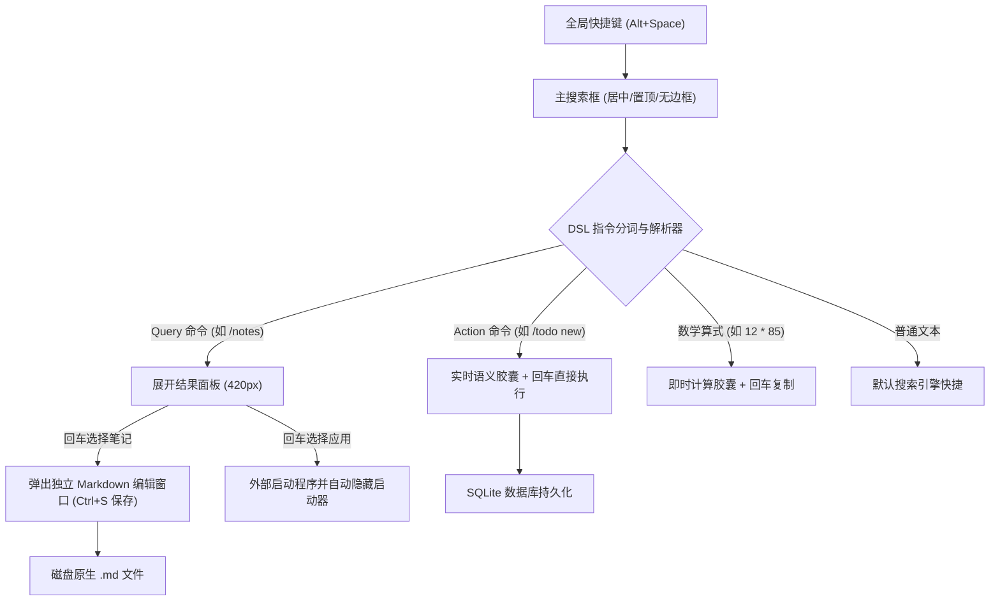

# ⚡ LiteLauncher (v3.0)

> **基于 Tauri 2 + SolidJS + SQLite (FTS5) 的下一代生产力启动器（Launcher）**  
> **核心理念：** Command-First, Window-as-Context, Plugin-Driven

---

## 📖 架构概览

搜索框作为启动器的唯一交互入口，所有功能均降级为“插件/指令”，窗口从“固定面板”变为“按需弹出的上下文容器”。



---

## ⌨️ 快捷键速查

| 快捷键 | 作用范围 | 功能说明 |
| :--- | :--- | :--- |
| **`Alt + Space`** | 全局 | 唤起 / 隐藏 LiteLauncher 主搜索框 |
| **`Enter` (回车)** | 主搜索框 | 执行即时命令 / 补全候选指令 / 选择当前高亮项 |
| **`Esc`** | 主搜索框 | 若有文本优先清空；文本为空时隐藏主窗口 |
| **`↑ / ↓`** | 结果面板 | 在列表项之间快速切换选择高亮 |
| **`Ctrl + S`** | 独立编辑器 | 立即保存当前 Markdown 文件并增量更新 SQLite 索引 |

---

## 🚀 指令系统

### 1. 应用启动 (`/app`)
- **Query 模式**：输入 `/app` 或 `/app [关键字]` 过滤系统应用，敲击回车直接唤起程序并自动隐藏启动器。
- **Action 模式**：输入 `/app add "应用名称" "可执行路径"`，实时预览胶囊，回车持久化保存至捷径库。
- **拼音简写**：支持直接输入 `jsq`（计算器）、`jsb`（记事本）智能推荐。

### 2. 待办日程 (`/todo`)
- **Action 即时添加**：
  - `/todo new "下午技术周会" 14:30` → 今天 14:30 提醒。
  - `/todo new "周报撰写" fri 09:00` → 周五 09:00。
  - `/todo new "晨会" daily 08:30` → 每天 08:30。
  - 实时解析出内容与提醒标签，敲击回车直接写入 SQLite，Toast 提示并清空输入框。
- **Query 列表管理**：
  - 输入 `/todo` 展开待办列表（未完成置顶），回车一键切换已完成/待办状态。

### 3. Markdown 笔记 (`/notes`)
- **文件原生优先**：
  - 默认管理目录：`%USERPROFILE%\Documents\LiteNotes`。
  - 启动时自动增量比对文件 `mtime`，提取标题与前 500 字纯文本摘要写入 SQLite FTS5 全文索引库。
  - 数据库不存储正文，正文始终为磁盘原生文件。
- **双窗口协作**：
  - 输入 `/notes [关键字]` 极速全文检索与摘要高亮。
  - 敲击回车弹出独立 Markdown 编辑器窗口（双栏编辑实时预览、`Ctrl+S` 原生保存、独立生命周期）。

### 4. 辅助指令与计算
- **帮助指南**：`/help` 查看所有已注册指令与语法。
- **实时计算器**：输入任意算术表达式（如 `12 * 85 + 3.14`），实时展现计算结果，回车一键复制。
- **无斜杠直达**：输入 `todo`、`notes`、`app` 自动智能映射到对应指令。

---

## 🛠️ 本地开发与构建

### 1. 环境准备
- **Node.js**：`v24.14.0`（通过 `nvm use 24.14.0` 激活）
- **Rust**：`1.99.0` (MSVC) + C++ 构建工具 (Visual Studio 2022)

### 2. 启动开发模式
```powershell
# 1. 激活 Node 环境
nvm use 24.14.0

# 2. 启动 Tauri 开发调试服务器
npm run tauri dev
```

### 3. 生产打包构建
```powershell
# 前端生产打包
npm run build

# Tauri 桌面客户端全量打包
npm run tauri build
```
