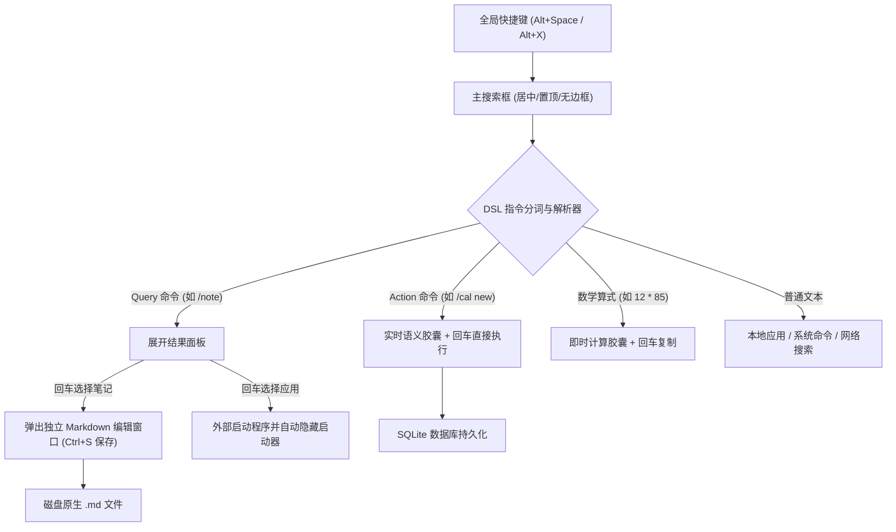

# ⚡ LiteLauncher (v3.0)

> **基于 Tauri 2 + SolidJS + SQLite (FTS5) 的下一代生产力启动器（Launcher）**
> **核心理念：** Command-First, Window-as-Context, Plugin-Driven
>
> 文档入口：[docs/README.md](docs/README.md) ｜ Agent 入口：[AGENT.md](AGENT.md)（状态以 `CHANGELOG.md` 与代码为准）

---

## 📖 架构概览

搜索框作为启动器的唯一交互入口，所有功能均降级为"插件/指令"，窗口从"固定面板"变为"按需弹出的上下文容器"。



**进程模型**：单实例常驻（系统托盘），关闭窗口仅隐藏、退出走托盘菜单"退出"。主窗口按内容高度动态伸缩（70px 搜索条 ↔ 最多 640px 面板），失焦自动隐藏（带 1.5s 启动保护期）。

---

## ⌨️ 快捷键速查

| 快捷键 | 作用范围 | 功能说明 |
| :--- | :--- | :--- |
| **`Alt + Space`** | 全局 | 唤起 / 隐藏 LiteLauncher 主搜索框（可在设置 → 快捷键改键） |
| **`Alt + X`** | 全局 | 主热键注册失败时的自动回退键 |
| **`Alt + Shift + S`** | 全局 | 免开启动器直接拖拽框选区域截图（可在设置 → 快捷键改键） |
| **`Enter` (回车)** | 主搜索框 | 执行即时命令 / 补全候选指令 / 选择当前高亮项 |
| **`Ctrl + Enter`** | 结果面板 | 结果项声明时执行次级动作（如打开所在文件夹） |
| **`Shift + Enter`** | 结果面板 | 结果项声明时执行次级动作（如复制路径） |
| **`Esc`** | 主搜索框 | 若有文本优先清空；文本为空时隐藏主窗口 |
| **`Esc`** | 笔记编辑器 | 关闭编辑器窗口 |
| **`↑ / ↓`** | 结果面板 | 在列表项之间快速切换选择高亮 |
| **`Ctrl + S`** | 独立编辑器 | 立即保存当前 Markdown 文件并增量更新 SQLite 索引 |
| **`F12`** | 任意窗口 | 打开 / 关闭 DevTools（开发调试用） |

---

## 🚀 指令系统

### 1. 应用启动 (`/app`)
- **Query 模式**：输入 `/app` 或 `/app [关键字]` 过滤应用，敲击回车直接唤起程序并自动隐藏启动器。
- **Action 模式**：输入 `/app add "应用名称" "可执行路径"`，实时预览胶囊，回车持久化保存至捷径库。
- **自动收录**：首次启动后台扫描开始菜单与桌面，已装应用无需手动添加；`/app rescan` 可强制重扫。
- **中文检索**：支持全拼与首字母——`wx` 命中微信、`vsc` 命中 Visual Studio Code；启动次数越多排得越前。
- **手动优先**：`/app add` 添加的条目永不被扫描覆盖；裸命令种子在同名系统快捷方式出现时自动升级为真实路径。

### 2. 日程管理 (`/cal`)
- **日程窗口 (`/cal app`)**：960×720 独立窗口，**月 / 周 / 日三视图**；左侧按分类日历勾选过滤，顶部一次 `query_range` 拉取当前区间的全部实例（含重复展开）。
  - 月视图：每日堆叠条目 + 跨天条带；周/日视图：00–24 竖排时间轴，重叠日程自动分道。
  - 时间轴上**按住空白处拖动即可新建**（按 15 分钟吸附），拖动已有条目可改时间。
  - `/cal today` 直达今天的日视图，`/cal week` 直达本周。
- **Action 即时添加**：
  - `/cal new "需求评审" 10-15 14:00-15:30` → 指定日期 + 区间。
  - `/cal new "周报" 2026-10-12` → 只给日期即为**全天事项**（不占时间轴格子）。
  - `/cal new 明天下午三点 项目评审` → 自然语言时间兜底（明天/后天/周几/下周几、上午/下午/晚上、3点半/15:30、1小时/半小时）；显式时间语法优先，引号内标题不参与解析。
  - `14:30` 简写按今天理解，该时刻已过则顺延至明天；`M-D` 省略年份时过期的日子按明年理解。
  - 修饰参数：`--al 10,30`（多条提醒，提前分钟数）、`--al none`（显式关闭）、`--where 会议室`、`--note 备注`、`--cal 工作`（分类）、`--all-day`、`--free` / `--busy`（忙闲）。未知 `--flag` 静默忽略，裸词一律留作标题。
  - 实时语义胶囊回显解析结果（`🗓 10-15 14:00–15:30 · 📍会议室 · ⏰ -30min/-10min · 🔁 每周`），回车写入 SQLite；保存后若与既有日程重叠会附带提示。
- **间隔重复**：
  - `every:30min` / `every:2hour` / `every:1day` / `every:1week` / `every:1month` / `every:1year`，月度按日历推进、月末自动安全进位（1-31 号不会崩）。
  - 关键词：`daily`（每天）、`weekly`（每周）、`monthly`、`yearly`、`mon`..`sun`（每周指定星期）。
  - 重复规则的终止由 `repeat_until` 表达（`'YYYY-MM-DD HH:MM'` 或 `count:N`），`.ics` 导入的 `UNTIL` / `COUNT` 会落在这里；日历渲染的是区间内**展开后的每一个实例**。
- **多提醒 × 重复触发**：
  - 每条提醒在每个实例上**独立幂等**（复合主键 + `ON CONFLICT DO NOTHING`），重启不重弹。
  - 到点双通道提醒：**桌面右下角常驻卡片**（无边框置顶、不抢焦点，可拖走，点「我知道了」或 ✕ 才关；「查看详情」打开只读日程面板，面板里可就地「编辑」）+ **系统级通知**（进通知中心留历史），主窗口隐藏时依然有效。
  - 提醒卡与详情窗都是**宿主通用基窗**（标准三段式：标题栏 / 内容区 / 状态栏）：没有系统标题栏，拖标题行即可移动，**窗口高度跟着内容走**（编辑态展开就长高，顶边不动），内容超出上限时只有内容区滚动，标题与底部按钮行始终在手边。
  - 关机/睡眠错过的提醒**只记账不补弹**，避免开机一次性炸出十几条弹窗。
- **分类日历**：`/cal cal add 工作 #4c8dff` · `/cal cal rm 生活` · `/cal cal list`，每个分类一种颜色，窗口内可勾选显隐。
- **`.ics` 双向**：`/cal export [天数]`（默认 90 天，落在"下载"目录）· `/cal import ~/downloads/plan.ics`；窗口内也有导入/导出按钮（导入走文件选择器）。按 **UID 幂等**——同一条日程重复导入只更新、不产生副本。
- **Query 列表管理**：`/cal` 或 `/cal list 关键字` 展开清单（未完成置顶），回车一键切换完成状态；`/cal done 周报` · `/cal del 周报` 按标题匹配，**命中多条会拒绝执行而不是猜一条**。
- **设置**：`todo.default_duration_min`（新建日程的默认时长，`end_at` 缺省时用它补齐）；待办管理面板的「设置 → 测试弹窗」可随时弹一张提醒卡片预览。
- **兼容 `/todo`**：`/todo` 注册为隐藏别名（同一个 `plugin_id`），老指令、老数据、老管理窗口视图全部照常可用；斜杠补全与 `/help` 里只显示 `/cal`。

### 5. 应用设置 (`/setting`)
- **皮肤切换**：亮色 / 暗色主题一键切换，立即生效并同步到所有窗口（启动器、笔记编辑器、待办面板、提醒弹窗、设置面板），选择持久化保存。
- **版本信息**：应用版本、运行平台与架构、数据目录位置。
- 窗口可通过 `✕ 关闭` 按钮或窗口右上角关闭按钮关闭（应用保留托盘常驻）。

### 3. Markdown 笔记 (`/note`)
- **文件原生优先**：
  - 默认管理目录：`%USERPROFILE%\Documents\LiteNotes`。
  - 启动时自动增量比对文件 `mtime`，提取标题与纯文本摘要写入 SQLite FTS5 全文索引库。
  - 数据库不存储正文，正文始终为磁盘原生文件。
- **双窗口协作**：
  - 输入 `/note [关键字]` 极速全文检索与摘要高亮。
  - 敲击回车弹出独立 Markdown 编辑器窗口（双栏编辑实时预览、`Ctrl+S` 原生保存、`Esc` 关闭）。
  - 编辑器窗口按文件路径去重：同一篇笔记重复打开只会聚焦既有窗口。

### 4. 辅助指令与计算
- **帮助指南**：`/help` 查看所有已注册指令与语法。
- **实时计算器**：输入任意算术表达式（如 `12 * 85 + 3.14`），实时展现计算结果，回车一键复制。
- **无斜杠直达**：输入 `cal`、`todo`、`note`、`app` 自动智能映射到对应指令。
- **模糊容错**：输入 `/not`、`/notes` 等前缀会推荐 `/note` 候选，回车一键补全。

---

## 🧩 插件体系

LiteLauncher 遵循**"一切皆插件"**：功能不硬编码进壳层，一律以插件形态接入。按落地形态分四类，共用同一注册表、同一 IPC 通道（`plugin_call`）与同一份能力集合，**壳层对它们零特判**。

| 形态 | `backend.kind` | 代码位置 | 运行时依赖 | 重编译主程序 | 典型场景 |
| :--- | :--- | :--- | :--- | :--- | :--- |
| **native 动态库** | `native` | `plugins/<id>/{manifest.json, native/, be/, fe/}` + `<id>.dll` | 无（同进程） | 不需要，拷目录即装 | 官方件与要直连系统 API 的：`todo` `apps` `ai` `notes` `pomo` `find` `sysinfo` `echo` |
| 外部插件（LLP/1） | `llp` | `plugins/<id>/{manifest.json, 脚本}` | 任意语言运行时（Python 等） | 不需要，拷目录即装 | 算法密集 / 纯计算：`hash` `cron` `cidr` `cost` |
| **纯前端插件** | `none` | `plugins/<id>/{manifest.json, fe/}` | **无** | 不需要 | 纯计算 / 文本 / 换算类小工具 |
| ~~编译期插件~~（遗留） | uiltin | plugins/<id>/{be,fe} | 无 | 需要 | M5 起已零使用：仓库内所有官方插件都走 native |

### ✨ 纯前端插件（`backend.kind = "none"`）

没有 Rust crate、也没有 sidecar——**全部逻辑就是一个 TS 文件**（`fe/src/index.ts` + `fe/package.json`），随前端包编译进应用。插件的能力来自**宿主保留方法名空间 `svc.*`**，由宿主直接应答（不是插件自己的后端）：

| 方法 | 权限（manifest `permissions`） |
| :--- | :--- |
| `svc.settings.get` / `set` | —（宿主强制 `${pluginId}.` 前缀隔离） |
| `svc.clipboard.write` / `read` | `clipboard:write` / `clipboard:read` |
| `svc.db.migrate` / `execute` / `query` | `db`（migrate 仅 DDL，execute 仅 DML，query 仅 SELECT） |
| `svc.http.send` | `net:<host>` 域名白名单 |
| `svc.notify.send` | `notifications` |
| `svc.events.emit` | —（前端按 pluginId 过滤） |
| `svc.process.launch` | `process` |
| `svc.log.write` | — |
| `svc.screen.list` / `cursor` / `pixel` / `capture` | `screen`（截图与取色） |
| `svc.shortcut.register` / `unregister` / `list` | `shortcut:<accel>`（逐条声明、**无通配**） |
| `svc.window.open` | `windows`（只能打开 manifest `views` 里声明过的视图） |
| `svc.window.setContentSize` | `windows`（**只能改自己所在的视图窗口**，且改高度要求该视图声明 `auto_height`） |

前端 SDK 把这些封装成同名属性，写起来就是普通方法调用：

```ts
const ctx = getPluginContext('myplug');
await ctx.clipboard.write('复制这段');        // → svc.clipboard.write
await ctx.settings.setJson('items', [...]);  // → svc.settings.set（自动 JSON 序列化）
const data = await ctx.http.json<T>(url);    // → svc.http.send（需 manifest 声明 net:<host>）

const shot = await ctx.screen.capture({ monitor: -1, hideWindows: true, delayMs: 3000 });
const { sample } = await ctx.screen.pixel({ radius: 7 });  // 取光标处颜色 + 放大镜方格
await ctx.windows.open('panel', { id: '1' });             // 打开本插件声明的视图窗口
await ctx.windows.setContentSize({ height: 240 });        // 基窗：上报内容自然高度，锚定与夹取由宿主做

await ctx.shortcuts.register('alt+p');                    // manifest 需声明 shortcut:alt+p
await ctx.shortcuts.on('alt+p', () => { /* 任意界面按下都会到这里 */ });
```

### 🪟 通用基窗（视图窗口的通用外壳）

标准窗口是**三段式**：标题栏（可隐藏、整行拖拽、可放按钮）/ 内容区（唯一的滚动区）/ 状态栏（可隐藏、放按钮或状态文案）。

"在桌面上放一张卡片"是插件最常见的形状。自己拼要重复踩三个坑：去掉标题栏后没法拖、高度要跟着内容、内容超长要滚。
宿主把它收成一项能力：manifest 里声明 `decorated:false` + `auto_height:true` + `max_height`，前端套一层 `PopupFrame`，
就得到一个**无系统标题栏、可拖拽、高度自适应、超长时只滚内容区**的实心窗口（圆角交给系统）。
物理/逻辑像素换算与四角锚定**只在宿主做**并有单测——插件不再手工量屏幕、拼坐标。
日历窗口与设置窗口也走同一套壳（`fill` 定尺寸模式：窗口大小归用户，标题/状态栏照样钉死，长内容只滚内容区）。
两处平台例外写进了指南（Linux/GTK 会忽略不可 resize 窗口的 `set_size`；`index.html` 的 `#root` 是 ID 权重，底色与字色要重写到它上面）。
用法与代价见 `docs/guides/plugin-development-guide.md` §5.6。

### 已实现插件

**纯前端 · 纯计算工具（`kind: none`，零依赖、零重编译）· 8 个**

| 指令 | 名称 | 说明 |
| :--- | :--- | :--- |
| `/text` | 文本处理 | 大小写、反转、snake/kebab/camel/pascal/title、去空白 + 字符/词/字节统计 |
| `/json` | JSON 工具 | 美化 / 压缩 / 转义 / 结构摘要，解析失败给出错误信息 |
| `/rand` | 随机生成 | uuid / str / num / coin / dice / pick |
| `/ts` | 时间戳转换 | 时间戳 ↔ 日期，自动识别秒/毫秒/微秒/纳秒，含相对时间 |
| `/unit` | 单位换算 | 长度/质量/面积/数据/速度/时间/温度 + `hex/bin/oct/dec` 进制转换 |
| `/color` | 颜色转换 | HEX / RGB(A) / HSL(A) / HSV / 互补色 / Alpha |
| `/regex` | 正则测试 | 常用正则速查；表达式校验；样本文本匹配与分组 |
| `/qr` | 二维码 | 生成二维码并在浏览器打开（联网取图；演示 `svc.process.launch`） |

**纯前端 · 网络类（`kind: none` + `net:<host>` 白名单，免密公共 API）· 5 个**

| 指令 | 名称 | 说明 |
| :--- | :--- | :--- |
| `/weather` | 天气查询 | `/weather 北京` 实况 + 今日预报，英文天气词自动映射为中文（数据源 wttr.in） |
| `/fx` | 汇率换算 | `/fx 100 usd cny` 精确换算、`/fx usd cny` 看汇率、`/fx usd` 列主要货币（数据源 open.er-api.com） |
| `/ip` | IP 查询 | `/ip` 本机公网 IP 与归属地，`/ip 8.8.8.8` 查指定 IP 的运营商/ASN/时区（数据源 ipwho.is） |
| `/dict` | 英文词典 | `/dict hello` 音标、词性、释义、例句，回车打开发音（数据源 dictionaryapi.dev） |
| `/tr` | 翻译 | `/tr hello world` 自动中英互译，`/tr en ja hello` 指定语言对（数据源 MyMemory，有每日额度） |

> **网络插件范式（重要）**：壳层对 `query()` 是**逐键调用且无防抖**的，所以网络类插件**绝不在 `query` 里发请求**——输入时只渲染一个「查询」项，真正的抓取发生在**用户回车**时（`onSelect`），结果按输入缓存（TTL 5–30 分钟），抓取完成后返回 `refresh` 让面板就地刷新。这样既不会边打字边打 API，也不引入防抖竞态。

**纯前端 · 桌面能力（`kind: none` + `screen` / `shortcut:<accel>`）· 2 个**

截图与取色都不需要任何平台代码——抓屏、多屏定位、窗口避让、PNG 落盘全在宿主（D 组能力包，见 `docs/records/plugin-roadmap.md` §11）。

| 指令 | 名称 | 说明 |
| :--- | :--- | :--- |
| `/shot` | 屏幕截图 | 回车区域框选（推荐）或整屏截图（截前自动隐藏 LiteLauncher）、`/shot 2` 指定显示器、`/shot -d3` 延时 3 秒；完成后图片进剪贴板，面板出现「用系统查看器打开 / 打开所在文件夹 / 复制路径」。**全局热键 `alt+shift+s`** 免开启动器直达区域框选 |
| `/pick` | 取色器 | **全局热键 `alt+p`** 取光标处像素 → HEX 进剪贴板 + 通知；`/pick` 另有「取光标处颜色」「打开浮动取色台」「最近取色（HEX/RGB/HSL 可切换复制）」「清空历史」。取色台是声明式视图窗口：放大镜实时跟随鼠标，**鼠标移入面板即冻结**（否则会采到面板自己的颜色），点按钮复制 |

截图统一保存到 `%LOCALAPPDATA%\LiteLauncher\screenshots`；最多 500 张或 30 天，超出自动清理，只删 `shot-*.png`，不会碰你手动放进目录的其他图片。

> **全局热键协议**：manifest 以 `shortcut:<accel>` 逐条声明（无通配），宿主登记并**仲裁冲突**（同一加速键先到先得），触发时广播 `plugin-shortcut` 事件，插件用 `ctx.shortcuts.on(accel, cb)` 接收——插件拿不到原始按键流。`on()` 默认只在**主窗口**生效（每次窗口加载都会跑一遍全部插件的 `setup`，不区分就会重复触发）；取色台这类需要在视图窗口内响应热键的场景显式传 `{ scope: 'any' }`。

**native 动态库（`kind: native`，进程内、零运行时依赖）· 8 个**

| 指令 | 名称 | 说明 |
| :--- | :--- | :--- |
| `/todo` `/app` `/ai` `/note` | 日程 / 应用 / AI / 笔记 | 各自带独立窗口，行为见上面各章 |
| `/pomo` | 番茄钟 | `/pomo start 25 写代码`，专注↔短休按 **5:1** 交替；到点发系统通知并自动接下一段，`/pomo auto off` 改为每段结束等人工点挂件的 ▶；挂件被关掉后 `/pomo start`（不带参数）或 `/pomo widget` 可不重置计时地找回；`/pomo pin` 可贴到壁纸层 |
| `/find` | 文件搜索 | 全盘文件按名称毫秒级搜索：Windows 进程内直调 Everything SDK，Linux 走 plocate（无索引时降级 fd / find）；`ext:rs` / `size:>500mb` / `dm:today` 字段语法，`desc size` 排序；回车打开，目录自动记入 recent |
| `/sysinfo` | 系统信息 | 内核/内存/磁盘/开机时长 + **主程序与子进程内存占用**（webview、插件 sidecar 按名称聚合）；Windows 走 Win32、Linux 读 `/proc`，无 Python 依赖 |

> **native 插件双平台都能装**：`backend.entry` 写多个产物名（`["find.dll", "libfind.so"]`），
> 宿主按**当前平台后缀**挑一个（`ll-plugin-api::native_lib_suffix`），`integrity` 由构建脚本
> 回填为本平台那份产物的 hash。`/find` 在 Windows 上走 Everything，在 Linux 上走 plocate（见下）。

**纯前端内置（原 Python 迁移）· 5 个**

*这些指令现在随前端包分发，干净 Windows 无需 Python 即可用：*

| 指令 | 名称 | 说明 |
| :--- | :--- | :--- |
| `/hash` | 哈希与编码 | md5/sha1/sha256/sha512/base64/url/html/crc32；`/hash md5 文本` 或 `/hash 文本` |
| `/cron` | Cron 解析 | 5 段表达式 → 人类可读描述 + 未来 5 次触发时间 |
| `/cidr` | 网段计算 | 网络/广播/掩码/可用范围/主机数，支持 IPv6 与子网拆分 |
| `/pwd` | 密码生成器 | `/pwd 24`、`easy`、`nosym`；含 PIN 与记忆短语（Web Crypto） |
| `/time` | 世界时钟 | 主要城市时间与时差（Intl 时区数据） |

**外部插件（LLP/1，Python sidecar）· 5 个**

*有状态或依赖 Python 标准库的仍走 LLP*：

| 指令 | 名称 | 说明 |
| :--- | :--- | :--- |
| `/bookmark` | 书签收藏 | `add "标题" URL` / `del 序号`；回车在浏览器打开 |
| `/snip` | 文本片段 | 常用短语存取，回车即复制 |
| `/cost` | 快速记账 | `add 25 午餐`；今日/本月合计与分类汇总 |
| `/memo` | 备忘速记 | 速记与检索 |
| `/cheat` | 命令速查 | 内置 git/docker/k8s 等常用命令，可增删 |

> **`/find` 依赖系统索引**：Windows 用 Everything（插件目录自带 `bin/Everything64.dll`，索引库由
> Everything 本体维护，没装/没运行时会直接给安装引导）；Linux 用 plocate，**装索引前基本不可用**：
>
> ```bash
> # Debian / Ubuntu（Ubuntu 22.04+ 装完自带每日自动建库的定时任务）
> sudo apt install plocate && sudo updatedb
>
> # Fedora / RHEL
> sudo dnf install plocate && sudo updatedb
> ```
>
> 没装索引时降级为 fd / find 实时遍历（只搜用户目录、每查一次全扫一遍）；装 `fd-find` 能改善降级体验。
> `/find where` 可查看当前后端与索引状态。Windows 侧的 DLL 查找顺序：插件 `bin/` → `LITE_EVERYTHING_DLL` → 常见安装目录 → `bin/Everything32.dll`。

> 所有"回车复制"依赖壳层的通用 `AfterSelect.copy` 能力（工具类插件的标准交互），落点为**宿主原生剪贴板**（`clipboard_write`），而非 webview 的 `navigator.clipboard`——后者在窗口即将隐藏时会被浏览器策略拒绝。

### 安装与卸载

Windows 安装包：

```bat
build.cmd ship
```

产物在 `src-tauri\target-ship\release\bundle\nsis\`，插件会随包安装到
`$INSTDIR\plugins`。便携版仍可直接用 `release\LiteLauncher.exe` + `release\plugins\`。
签名、更新源与自动更新配置见 [docs/guides/distribution.md](docs/guides/distribution.md)。

```bash
# 安装全部外部插件到用户目录（~/.local/share/LiteLauncher/extplugins/）
npm run plugin:install

# 只装一个 / 装成便携版（随 release/ 一起分发）
npm run plugin:install -- hash
npm run plugin:install -- --all --portable

# 卸载：删除对应插件目录即可
```

> - 纯前端插件（`kind: none`）的代码已编译进应用包，安装时**只部署 `manifest.json`**——宿主据此注册插件，权限门控与设置面板的启用/禁用都依赖它。开发期宿主会自动扫描仓库 `plugins/`，无需安装。
> - ⚠️ LLP 插件需要目标机器有对应运行时（Python 插件需 Python 3）。宿主按 **设置 → Python 环境** → `LLP_PYTHON` 环境变量 → `PATH` → 注册表 → 常见安装位置 的顺序自动探测，可在设置面板手动指定。

### 开发与测试

```bash
# LLP 插件冒烟测试：逐个走一遍 initialize/search/execute 协议
npm run plugin:test        # 可用 LLP_PYTHON 指定解释器

# 纯前端插件测试：Node 里直跑插件逻辑，断言真实计算结果（不启动 Tauri）
npm run plugin:test:fe

# native 插件单测：业务逻辑在 plugins/<id>/be，不启动 Tauri、也不需要宿主
cargo test --manifest-path plugins/find/be/Cargo.toml
cargo test --manifest-path plugins/sysinfo/be/Cargo.toml
```

---

## 🛠️ 本地开发与构建

### 1. 环境准备
- **Node.js**：`v24+`
- **Rust**：`1.99+`（stable）
- **Windows 构建工具**：二选一
  - MSVC 工具链：Visual Studio 2022 C++ 构建工具（官方默认路径），或
  - GNU 工具链：`rustup default stable-x86_64-pc-windows-gnu` + 完整 MinGW binutils/gcc（无需管理员权限）
- **Linux 系统依赖**（Debian 12 / Ubuntu 一类，`build.sh` 会预检并在这一步失败时打印同一条命令）：
  ```bash
  sudo apt-get install -y build-essential pkg-config libclang-dev \
    libgtk-3-dev libwebkit2gtk-4.1-dev libjavascriptcoregtk-4.1-dev \
    libsoup-3.0-dev libgbm-dev libpipewire-0.3-dev libspa-0.2-dev
  ```
  每一项都对应一个真实的编译期探针，不是照着清单凑的：
  `libclang-dev`（bindgen 找 `libclang.so`，`xcap → pipewire-sys / libspa-sys` 要先过它）、
  `libgbm-dev`（链接 `-lgbm`，机器上往往只有运行库 `libgbm.so.1`，缺的是 dev 符号链接）、
  `libpipewire-0.3-dev` / `libspa-0.2-dev`（`pkg-config` 探针，缺了就报
  `was not found in the pkg-config search path`）、webkit 三件套（Tauri webview）。
- 判据：报 `Unable to find libclang` 或 `was not found in the pkg-config search path`
  **都是缺 `-dev`，不是版本或代码问题，别去改 `build.rs`。**

### 2. 启动开发模式
```powershell
# 启动 Tauri 开发调试服务器（前端 Vite + Rust 增量编译）
npm run tauri dev
```

### 3. 构建与发布

**日常构建**（改完代码验证效果，用 `Cargo.toml` 里的快速档）：
```powershell
# 前端打包 + Rust release 编译 + 拷贝到 release\LiteLauncher.exe
build.cmd

# 等价的显式命令
npm run build
npx tauri build --no-bundle
copy /Y src-tauri\target\release\LiteLauncher.exe release\LiteLauncher.exe
```

**正式发布**（对外分发的那个包，唯一需要 `ship` 的场合）：
```powershell
build.cmd ship
```
`ship` 只改变 Rust 侧的优化档（fat LTO + 单 codegen unit，经 `CARGO_PROFILE_RELEASE_*`
环境变量覆盖 `Cargo.toml`，不需要手改文件），前端构建与便携插件部署步骤完全一致；
产物同样拷到 `release\LiteLauncher.exe`，后续校验/分发流程不变。
它把这类包编到独立的 `src-tauri\target-ship\` 目录，所以发版之后日常那份增量
缓存不会被换档作废（代价：首次 ship 会在新目录重编一遍全部依赖，多占约 8~9G）。

> **判据一句话**：自己看效果 → `build.cmd`；要发给别人的那个 exe → `build.cmd ship`。
>
> **为什么日常档不是最优化档**（`Cargo.toml` 的 `[profile.release]`）：
> `lto = true` + `codegen-units = 1` 只影响最后两个编译单元（ll-host 与 tauri-app），
> 却占了整场构建的绝大部分时间——前者要在链接期把上游所有 rlib 的 LLVM IR
> 合并重优化（无法并行），后者取消了 crate 内的并行编译。日常改成
> `lto = "thin"` + `codegen-units = 4`，发版用 `build.cmd ship` 拿回全部优化。

> ⚠️ **注意**：请使用 `npx tauri build`（或 `build.cmd`）打包，不要直接用 `cargo build --release`。
> 后者不会启用 `custom-protocol` 特性，产出的 exe 会去连 `localhost:1420` dev server，导致窗口白屏或"localhost 拒绝连接"。

**Linux 上 `./build.sh ship` 多打一个 `.deb`**（落在 `src-tauri/target-ship/release/bundle/deb/`，日常构建仍然 `--no-bundle`）：

- deb 的 `Depends` 是 Tauri 自己探模块写出来的**短列表**（本项目当前是
  `libayatana-appindicator3-1, libwebkit2gtk-4.1-0, libgtk-3-0`），**不是 `dpkg-shlibdeps`
  从 `ldd` 反推的**。它现在够用，但这是要验的，不是能假设的：把上面 3 项的
  传递依赖闭包和产物 `ldd` 的包归属对一遍，实测在本机是**完全覆盖**的
  （167 个 NEEDED、125 个包归属，差集为空；`libgbm1` / `libsoup-3.0-0` / `libicu72` / GStreamer
  都靠 `libwebkit2gtk-4.1-0` 一条链带进来）。
  覆盖关系靠的是 webkit 自己的 Depends 边，所以**新接一个直接依赖原生库的 crate**
  （或直接上 tray 之外的原生依赖）时这条链未必还罩得住，发版前要重跑一遍对账：
  ```bash
  # 差集为空 = deb 的 Depends 闭包罩得住产物的全部运行库
  deb=$(ls src-tauri/target/release/bundle/deb/*.deb)
  BIN=src-tauri/target/release/LiteLauncher
  comm -23 \
    <(ldd "$BIN" | awk '/=> \//{print $3}' \
        | while read -r l; do dpkg -S "$l" 2>/dev/null || dpkg -S "$(realpath "$l")" 2>/dev/null; done \
        | cut -d: -f1 | sed 's/:amd64$//;/^$/d' | sort -u) \
    <(dpkg-deb -f "$deb" Depends | tr ',' '\n' | sed 's/^ //' \
        | while read -r p; do apt-cache depends --recurse --no-recommends --no-suggests \
              --no-conflicts --no-breaks --no-replaces --no-enhances "$p" 2>/dev/null \
              | grep -E '^[a-z0-9]'; done \
        | sed 's/:amd64$//' | sort -u)
  ```
  （`dpkg -S` 要对 `/lib` 与 `/usr/lib` 两种路径各试一次：deb12 的 usr-merge 让同一 `.so`
  在两边有不同记法，只试一种会漏掉 `libc6`/`zlib1g` 那批。）
- **编译期那堆 `-dev` 一个都不用带到目标机**：头文件、`.pc`、`libgbm.so → libgbm.so.1` 这类符号链接只在链接阶段被读，运行期只要带 soname 的 `.so`（`libgbm1`、`libwebkit2gtk-4.1-0`，都不带 `-dev`）。
- 顺带一条实测结论：当前产物的 `NEEDED` 里**没有** `libpipewire-0.3.so` / `libspa`。`xcap` 只在 Wayland portal 截图路径用到 pipewire，那段代码经死代码消除后被 `--as-needed` 掉了 —— 装 `libpipewire-0.3-dev` 纯粹是"过编译"，对运行没有任何影响。
- 换机器自查（有输出就是缺运行库，装对应包，别装 `-dev`）：
  ```bash
  ldd LiteLauncher | grep "not found"
  ```
  真正决定能不能跑的是 webkit/GTK 那一坨：`libwebkit2gtk-4.1`、`libjavascriptcoregtk-4.1`、`libgtk-3`、`libsoup-3.0`、`libgbm1`、GStreamer、`libicu72`。带桌面的 Debian/Ubuntu 一般自带，精简镜像未必；`libicu72`、`libsoup-3.0` 这类 soname 里焊了版本号，跨发行版（如 Ubuntu 24.04 是 `libicu74`）会直接加载失败 —— 要跨发行版就自己加 `--bundles appimage`，代价是首次要联网下 linuxdeploy。
- **`.deb` 里只有主程序**，外部插件不在包内：装完把 `release/plugins/` 放到 `~/.local/share/LiteLauncher/extplugins/`（两级部署见 `src-tauri/src/lib.rs:194`）。Python 类插件（pomo 等）还要求目标机 PATH 上有 `python3`（`src-tauri/crates/ll-host/src/python.rs:161`）。

### 4. 排障日志
- `lifecycle.log`：生成在 exe 同目录。默认 `info`（启动/迁移/插件 init/热键），`LL_LOG=debug` 才记录窗口尺寸、焦点、IPC 与前端 console；`LL_LOG=off` 全关。超过 2 MB 时启动自动轮转为 `lifecycle.log.1`（只保留一份）。

---

## 📦 技术栈

| 层 | 技术 | 说明 |
| :--- | :--- | :--- |
| 桌面框架 | Tauri 2 | 无边框窗口、系统托盘、全局快捷键、多窗口 |
| 前端 | SolidJS + TypeScript + Vite | 响应式 UI，无虚拟 DOM |
| 后端 | Rust + rusqlite (bundled) | SQLite + FTS5 全文索引 |
| 存储 | 磁盘原生文件 + SQLite | 笔记正文永在磁盘，库只存索引 |

---

## 📄 License

MIT
